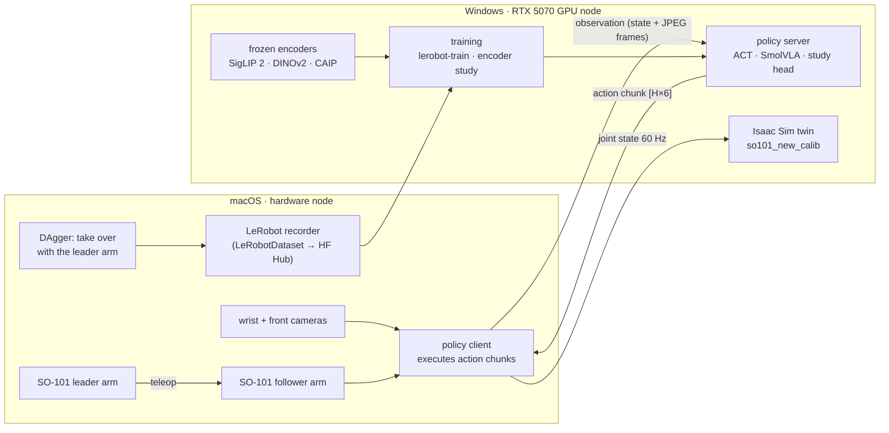
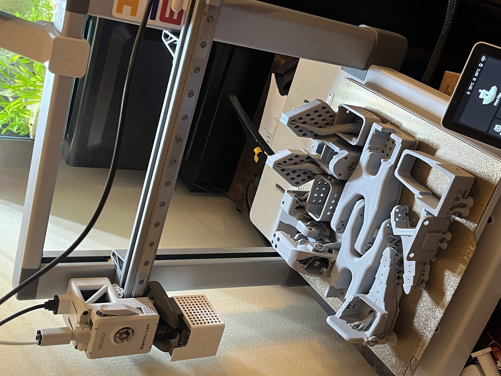
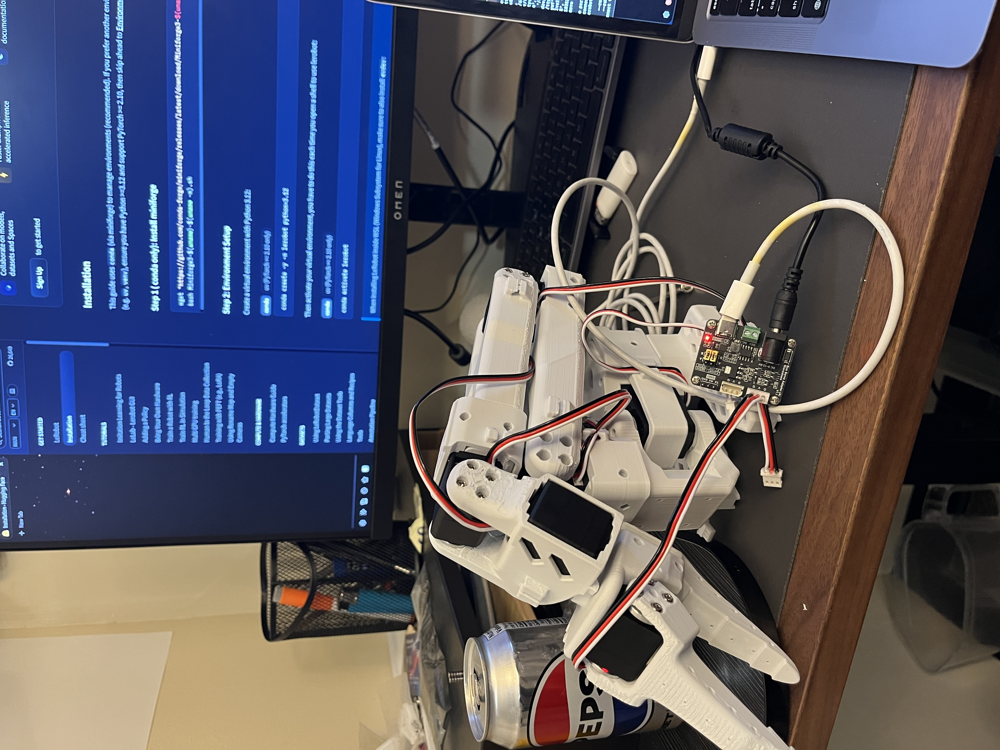
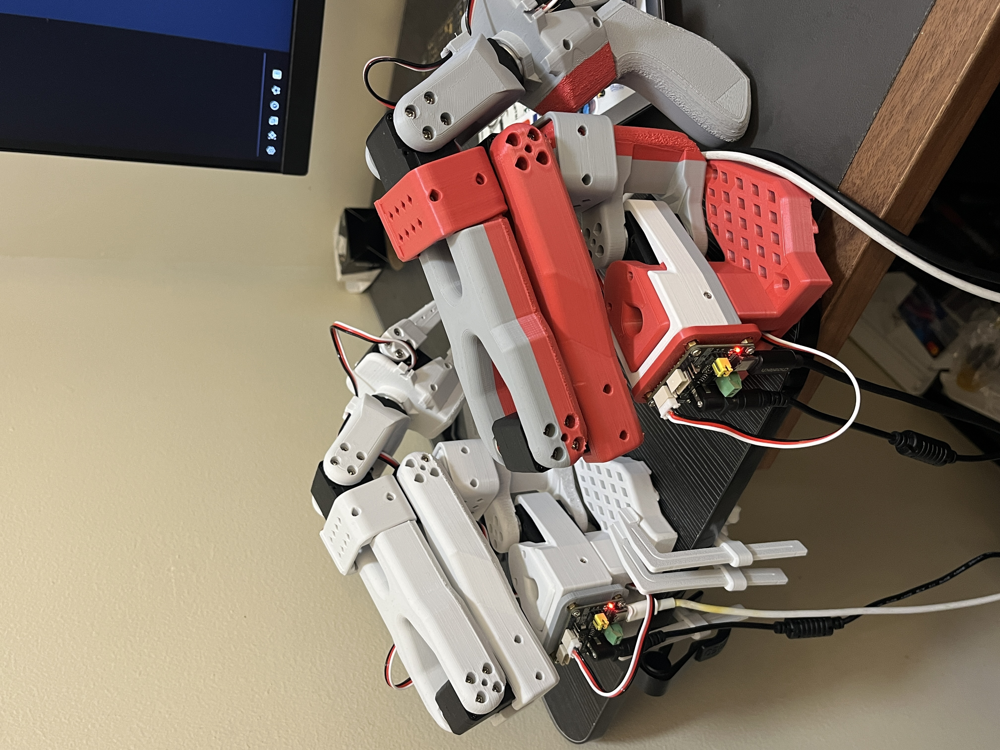
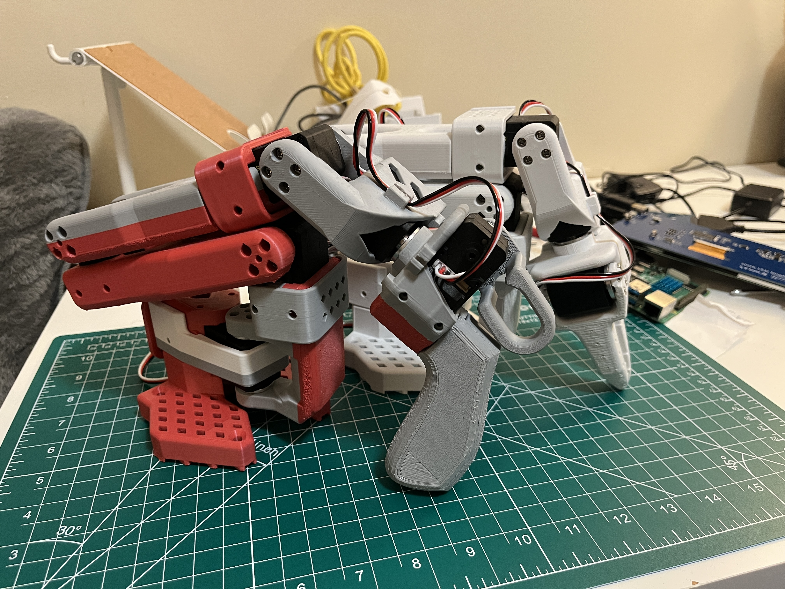

# SO-101 Real-to-Sim Robot Learning Platform


A low-cost robot learning platform built around a self-printed SO-101 arm: teleoperated data collection with cameras, imitation-learning and VLA baselines, a real-robot evaluation protocol with confidence intervals, an NVIDIA Isaac Sim digital twin, and a study of which frozen vision encoder transfers best to a cheap parallel gripper.



## Research question

[CAIP](https://caip-encoder.github.io/) (Sharma et al., 2026) pre-trains a ViT-L on about 32,000 hours of egocentric human video so its features predict future hand motion, and shows large gains on a 22-DoF dexterous-hand robot. The authors note that transfer to grippers is untested. This project tests it on the cheapest arm there is: the same policy head trained on frozen **SigLIP 2**, **DINOv2** and **CAIP** features, evaluated on the real SO-101 under normal light, changed light and distractor objects. A second ablation pools features only over a text-prompted object mask (OWLv2 + SAM), following [Learning to Grasp Anything by Playing with Random Toys](https://lego-grasp.github.io/) (ICLR 2026). Design and run steps: [docs/ENCODER_STUDY.md](docs/ENCODER_STUDY.md).

## Results

Real-robot success rates with 95% Wilson intervals, 16 placements on a fixed 4×4 grid per condition. Generated by `python -m vla.eval.summarize logs/eval/*.jsonl`.

| Policy | Nominal | Dim light | Distractors |
|---|---|---|---|
| ACT (from scratch) | pending | pending | pending |
| SmolVLA (fine-tuned) | pending | pending | pending |
| Head + SigLIP 2 (frozen) | pending | pending | pending |
| Head + DINOv2 (frozen) | pending | pending | pending |
| Head + CAIP (frozen) | pending | pending | pending |

## What's in the repo

| Path | What it does | Runs on |
|---|---|---|
| `bridge/joint_state.py` | Typed joint-state message, binary and JSON codecs | both |
| `bridge/policy_protocol.py` | Observation → action-chunk wire format (JSON header + JPEG frames + float32 actions) | both |
| `bridge/calibration.py`, `config/so101_twin_mapping.json` | Calibrated joint readings and raw Feetech ticks → Isaac Sim joint radians | both |
| `bridge/mac/publisher.py` | Streams the calibrated leader arm at 60 Hz | Mac |
| `bridge/mac/policy_client.py` | Executes a remote policy on the follower, measures round-trip latency, optionally mirrors to the twin | Mac |
| `bridge/windows/policy_server.py` | Hosts ACT / SmolVLA / study checkpoints on the GPU | Windows |
| `sim/so101_scene.py`, `sim/mirror.py` | Rebuilds the Isaac Sim scene from code; mirrors the real arm live or replays a recorded episode | Windows (Isaac Sim) |
| `scripts/record_dataset.sh` | Records camera + joint demos into a LeRobotDataset and pushes to the Hub | Mac |
| `scripts/train_baselines.ps1` | Trains ACT and fine-tunes SmolVLA with `lerobot-train` | Windows |
| `vla/eval/` | Grid-based real-robot evaluation, printable placement sheet, logged trials, results table | Mac |
| `vla/encoders/`, `vla/study/`, `scripts/run_encoder_study.ps1` | Frozen-encoder feature caching, mask pooling, shared transformer policy head | Windows |
| `vla/dagger.py` | Leader-arm DAgger: take over when the policy fails and record the correction | Mac |

Step-by-step commands for both machines: [docs/RUNBOOK.md](docs/RUNBOOK.md).

## Hardware build

| | |
|---|---|
|  |  |
| Structural links printed in-house on a Bambu Lab A1 | Partial assembly: Feetech STS3215 servos, wiring harness, driver board |
|  |  |
| Joint-level detail: servo horns, cabling, control board | Assembled arm, calibrated and teleoperated through LeRobot |

One leader and one follower arm (6× STS3215 each), calibrated with `lerobot-calibrate`. Isaac Sim 6.0 is built from source on an RTX 5070 (12 GB). Full specs and calibration values: [SO101_System_Architecture_Handover.md](SO101_System_Architecture_Handover.md).

## Status

- [x] SO-101 leader/follower printed, assembled, calibrated; teleoperation through LeRobot
- [x] Isaac Sim 6.0 built from source; SO-101 twin scene rebuildable from code
- [x] ZeroMQ joint-state bridge and remote policy server/client, unit-tested
- [x] Evaluation protocol, encoder study pipeline and DAgger tooling, unit-tested with fakes
- [ ] Cameras mounted and first dataset recorded
- [ ] ACT and SmolVLA baselines trained and evaluated on the real arm
- [ ] Live real-to-sim mirror recorded side by side
- [ ] Encoder study results

## Tests

```bash
pip install torch --index-url https://download.pytorch.org/whl/cpu
pip install -r requirements/dev.txt
pytest -q
```

The bridge, calibration, evaluation statistics, policy head training loop and DAgger state machine are tested with fake robots and a fake encoder, so CI runs without hardware, a GPU or model downloads.

## Next

- Sim evaluation harness: the same task in Isaac Lab with randomized lighting, camera pose and textures, compared against real success rates.
- Cheap touch sensing on the gripper for fragile objects.
- A second follower arm for bimanual tasks.
